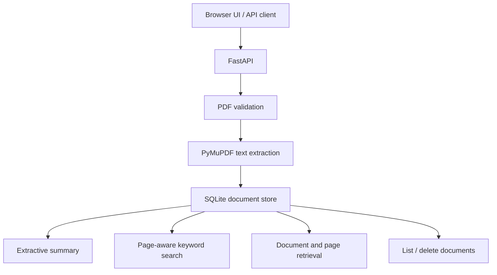

# DocuMind — Document Intelligence

A document-intelligence API and lightweight web interface that accepts text-based PDFs, extracts their text, creates extractive summaries, and searches uploaded documents.

> **Current scope:** MVP 0.4. Summaries are extractive (selected from the source text), not LLM-generated. Uploaded document text and metadata are stored in a local SQLite database. Scanned PDFs and OCR are not supported yet.

## Features

- PDF upload with file signature, size, content-type, and page-count validation
- Text extraction with PyMuPDF
- Extractive summaries using a transparent baseline algorithm
- Keyword-based search across saved documents
- SQLite persistence with page-level text records
- Document metadata and page retrieval endpoints
- Page-aware keyword search results with source locations
- PDF text-block geometry: bounding boxes, line counts, and font metadata
- Layout inspection endpoint for page-by-page text blocks
- Document listing and deletion
- FastAPI endpoints and interactive Swagger documentation
- Automated API tests and GitHub Actions CI

## Architecture



## Run locally

Requires Python 3.10 or newer.

```powershell
python -m venv .venv
.venv\Scripts\Activate.ps1
python -m pip install -r requirements.txt
python -m uvicorn app.main:app --reload
```

Open:
- App: http://127.0.0.1:8000
- Swagger UI: http://127.0.0.1:8000/docs
- Health check: http://127.0.0.1:8000/health

The default SQLite database is created at `data/documind.db`. Set `DOCUMIND_DB_PATH` to use another location.

## Run tests

```powershell
python -m pytest -v
```

## API

| Method | Endpoint | Purpose |
|---|---|---|
| GET | `/health` | Service health |
| POST | `/documents/upload` | Validate, extract, and save a PDF |
| GET | `/documents` | List saved documents |
| GET | `/documents/{document_id}` | Retrieve document metadata |
| GET | `/documents/{document_id}/pages` | Retrieve extracted text by page |
| GET | `/documents/{document_id}/layout` | Retrieve text blocks with page coordinates and font metadata |
| GET | `/documents/{document_id}/summary` | Return an extractive summary |
| DELETE | `/documents/{document_id}` | Delete a saved document |
| POST | `/documents/search` | Search saved documents by keyword; results include page numbers |

## Current extraction model

Each uploaded PDF is stored as a document record plus one text record per page. Search results include the page number, making it possible to trace a match back to its source location. Existing documents created before page-level storage are migrated into a page-one record when the application starts.

The layout endpoint preserves text-block bounding boxes, page dimensions, line counts, and font names from PyMuPDF. This is a geometry-preserving foundation for layout analysis, not yet automatic table reconstruction: multi-column layouts and complex tables may still require specialised detection. Scanned PDFs still require OCR.

## Next milestones

1. Infer reading order and reconstruct table rows/columns from preserved geometry.
2. Chunk layout-aware content, generate embeddings, and add vector retrieval.
3. Add an LLM provider adapter for grounded RAG answers with page citations.
4. Add OCR, authentication, rate limiting, observability, and deployment hardening.

## Security notes

The MVP enforces a 10 MB upload limit and a 100-page limit. It does not yet include authentication, malware scanning, OCR, or production-grade rate limiting. Uploaded text is stored locally without encryption. Do not upload confidential documents to an internet-facing instance.

## Run with Docker

```bash
docker compose up --build
```

The application is then available at http://127.0.0.1:8000. The SQLite database is stored in the container's `data/` directory; container recreation without a mounted volume can remove it.

## Continuous integration

GitHub Actions runs the automated test suite on pushes to `main` and `develop`, and on pull requests targeting `main`, using Python 3.11 and 3.12.

## License

MIT
