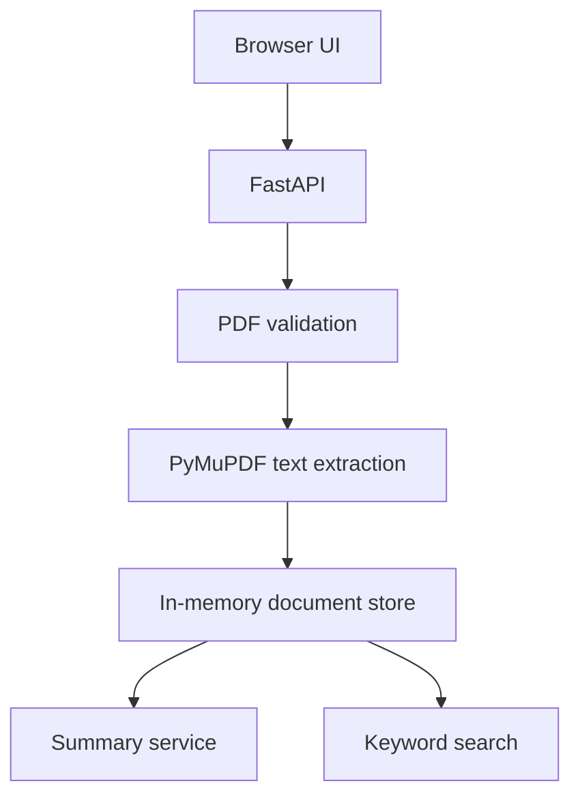

# DocuMind — AI Document Intelligence

A small document-intelligence application that accepts text-based PDFs, extracts their text, produces a lightweight extractive summary, and searches uploaded documents.

> **Current scope:** MVP 0.1. The summary is extractive (selected from the source text), not an LLM-generated answer. Documents are stored in memory and are cleared when the server restarts. Scanned PDFs and OCR are not supported yet.

## Features

- PDF upload with file signature, size, type, and page-count validation
- Text extraction with PyMuPDF
- Extractive summaries with a transparent baseline algorithm
- Keyword-based search across uploaded documents
- FastAPI endpoints and interactive Swagger documentation
- Basic automated tests

## Architecture



## Run locally

Requires Python 3.10 or newer.

```bash
python -m venv .venv
# Windows PowerShell: .venv\\Scripts\\Activate.ps1
# macOS/Linux: source .venv/bin/activate
pip install -r requirements.txt
uvicorn app.main:app --reload
```

Open:
- App: http://127.0.0.1:8000
- Swagger UI: http://127.0.0.1:8000/docs
- Health check: http://127.0.0.1:8000/health

## Run tests

```bash
pytest -q
```

## API

| Method | Endpoint | Purpose |
|---|---|---|
| GET | `/health` | Service health |
| POST | `/documents/upload` | Upload and extract a PDF |
| GET | `/documents/{document_id}/summary` | Return an extractive summary |
| POST | `/documents/search` | Search uploaded documents |

## Limitations and next milestones

1. Add persistent storage and document lifecycle endpoints.
2. Add chunking, embeddings, and vector retrieval for RAG.
3. Add an LLM provider adapter with grounded answers and source citations.
4. Add OCR for scanned PDFs and robust file-processing isolation.
5. Add CI, deployment, observability, and security hardening.

## Security notes

The MVP enforces a 10 MB upload limit and a 100-page limit. It does not yet include authentication, persistent storage, malware scanning, OCR, or production-grade rate limiting. Do not upload confidential documents to an internet-facing instance.

## License

MIT

## Run with Docker

```bash
docker compose up --build
```

The application is then available at http://127.0.0.1:8000.

## Continuous integration

GitHub Actions runs the automated test suite on pushes to `main`/`develop` and on pull requests targeting `main`, using Python 3.11 and 3.12.
