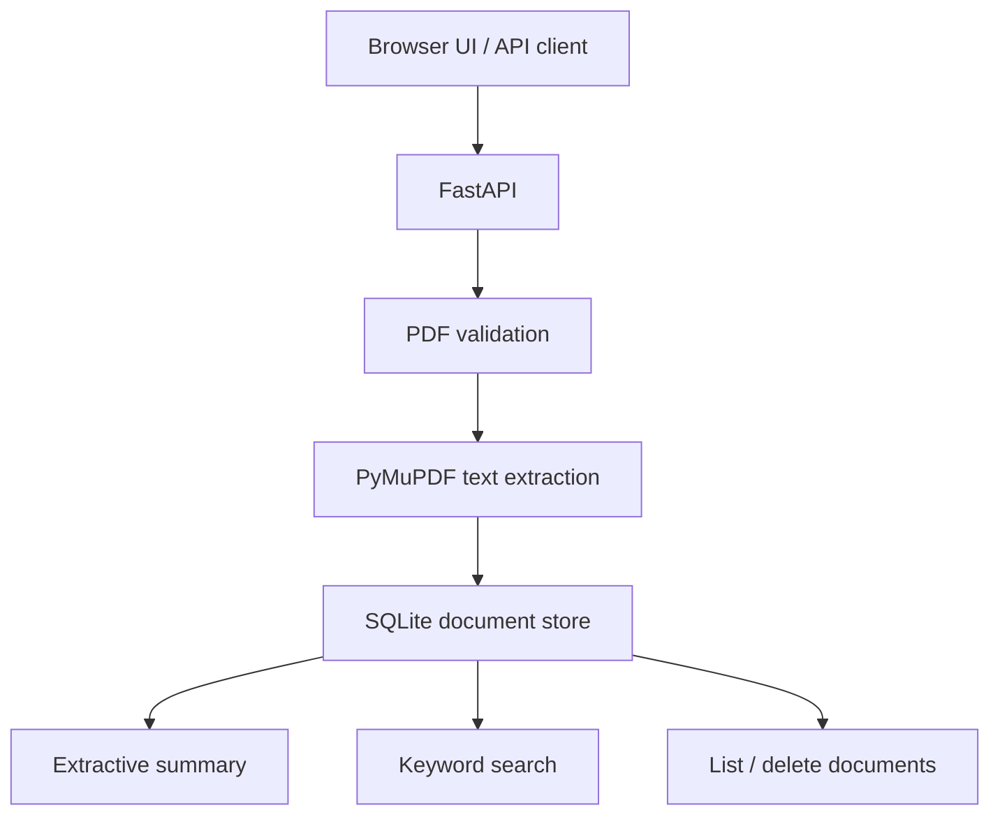

# DocuMind — Document Intelligence

A document-intelligence API and lightweight web interface that accepts text-based PDFs, extracts their text, creates extractive summaries, and searches uploaded documents.

> **Current scope:** MVP 0.2. Summaries are extractive (selected from the source text), not LLM-generated. Uploaded document text and metadata are stored in a local SQLite database. Scanned PDFs and OCR are not supported yet.

## Features

- PDF upload with file signature, size, content-type, and page-count validation
- Text extraction with PyMuPDF
- Extractive summaries using a transparent baseline algorithm
- Keyword-based search across saved documents
- SQLite persistence, document listing, and deletion
- FastAPI endpoints and interactive Swagger documentation
- Automated API tests and GitHub Actions CI

## Architecture



## Run locally

Requires Python 3.10 or newer.

```powershell
python -m venv .venv
.venv\Scripts\Activate.ps1
python -m pip install -r requirements.txt
python -m uvicorn app.main:app --reload
```

Open:
- App: http://127.0.0.1:8000
- Swagger UI: http://127.0.0.1:8000/docs
- Health check: http://127.0.0.1:8000/health

The default SQLite database is created at `data/documind.db`. Set `DOCUMIND_DB_PATH` to use another location.

## Run tests

```powershell
python -m pytest -v
```

## API

| Method | Endpoint | Purpose |
|---|---|---|
| GET | `/health` | Service health |
| POST | `/documents/upload` | Validate, extract, and save a PDF |
| GET | `/documents` | List saved documents |
| GET | `/documents/{document_id}/summary` | Return an extractive summary |
| DELETE | `/documents/{document_id}` | Delete a saved document |
| POST | `/documents/search` | Search saved documents by keyword |

## Limitations and next milestones

1. Add chunking, embeddings, and vector retrieval for RAG.
2. Add an LLM provider adapter with grounded answers and source citations.
3. Add OCR for scanned PDFs and robust file-processing isolation.
4. Add authentication, rate limiting, observability, and deployment hardening.

## Security notes

The MVP enforces a 10 MB upload limit and a 100-page limit. It does not yet include authentication, malware scanning, OCR, or production-grade rate limiting. Uploaded text is stored locally without encryption. Do not upload confidential documents to an internet-facing instance.

## Run with Docker

```bash
docker compose up --build
```

The application is then available at http://127.0.0.1:8000. The SQLite database is stored in the container's `data/` directory; container recreation without a mounted volume can remove it.

## Continuous integration

GitHub Actions runs the automated test suite on pushes to `main` and `develop`, and on pull requests targeting `main`, using Python 3.11 and 3.12.

## License

MIT
