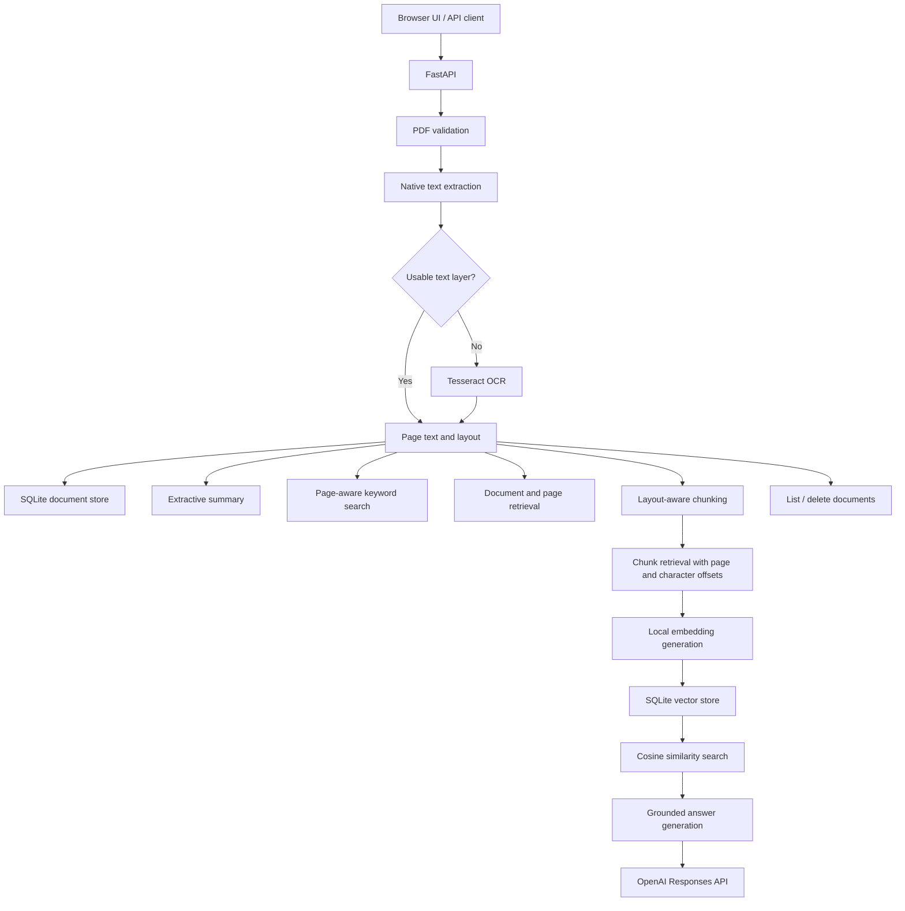

# DocuMind — Document Intelligence

A document-intelligence API and lightweight web interface that accepts text-based and scanned PDFs, extracts their text, creates extractive summaries, and searches uploaded documents.

> **Current scope:** MVP 0.8. Summaries are extractive (selected from the source text), not LLM-generated. Uploaded document text and metadata are stored in a local SQLite database. Scanned PDFs are processed with optional page-level OCR. Tesseract and its language data must be installed.

## Features

- PDF upload with file signature, size, content-type, and page-count validation
- Text extraction with PyMuPDF
- OCR fallback for image-based or text-sparse pages using Tesseract
- Extractive summaries using a transparent baseline algorithm
- Keyword-based search across saved documents
- SQLite persistence with page-level text records
- Document metadata and page retrieval endpoints
- Page-aware keyword search results with source locations
- PDF text-block geometry: bounding boxes, line-level coordinates, span-level coordinates, font names, and font sizes
- Word-level coordinates and heuristic table-candidate detection
- Persisted, overlapping page-aware text chunks with exact character offsets
- Local dense embeddings using FastEmbed and the BAAI/bge-small-en-v1.5 model
- Explicit document indexing and semantic search with page-level provenance
- Grounded RAG answers with source labels and page-level citations
- Layout inspection endpoint for page-by-page text blocks
- Document listing and deletion
- FastAPI endpoints and interactive Swagger documentation
- Automated API tests and GitHub Actions CI

## Architecture



## Run locally

Requires Python 3.10 or newer.

```powershell
python -m venv .venv
.venv\Scripts\Activate.ps1
python -m pip install -r requirements.txt
python -m uvicorn app.main:app --reload
```

Open:
- App: http://127.0.0.1:8000
- Swagger UI: http://127.0.0.1:8000/docs
- Health check: http://127.0.0.1:8000/health

OCR is triggered for pages with very little native text when the page contains raster images or vector drawings. Completely blank pages are left untouched. OCR uses Tesseract through PyMuPDF at 200 DPI by default. Set `DOCUMIND_OCR_LANGUAGE` to a Tesseract language code such as `eng` or `eng+fra`, and `DOCUMIND_OCR_DPI` to change the render resolution. Tesseract is a separate system dependency, not a Python package. On Windows, install Tesseract OCR and its language data, then set `TESSDATA_PREFIX` to the `tessdata` directory. The Docker image installs Tesseract and English language data automatically. OCR is slower than native text extraction.

The default SQLite database is created at `data/documind.db`. Set `DOCUMIND_DB_PATH` to use another location. FastEmbed downloads its default model on the first indexing request and caches it locally. Set `DOCUMIND_EMBEDDING_MODEL` to select another supported model and `FASTEMBED_CACHE_PATH` to change the model cache directory. Copy `.env.example` to `.env` and add an OpenAI API key to enable generated answers.

## Run tests

```powershell
python -m pytest -v
```

## API

| Method | Endpoint | Purpose |
|---|---|---|
| GET | `/health` | Service health |
| POST | `/documents/upload` | Validate, extract, and save a PDF |
| GET | `/documents` | List saved documents |
| GET | `/documents/{document_id}` | Retrieve document metadata |
| GET | `/documents/{document_id}/pages` | Retrieve extracted text by page, including extraction method and OCR status |
| GET | `/documents/{document_id}/layout` | Retrieve text blocks with page coordinates and font metadata |
| GET | `/documents/{document_id}/tables` | Return heuristic table candidates by page |
| GET | `/documents/{document_id}/chunks` | Retrieve persisted text chunks with page and character offsets |
| POST | `/documents/{document_id}/index` | Generate and persist local embeddings for a document's chunks |
| POST | `/documents/semantic-search` | Search indexed chunks by semantic similarity, with page provenance |
| POST | `/documents/ask` | Answer a question using retrieved document evidence and source labels |
| GET | `/documents/{document_id}/summary` | Return an extractive summary |
| DELETE | `/documents/{document_id}` | Delete a saved document |
| POST | `/documents/search` | Search saved documents by keyword; results include page numbers |

## Current extraction model

Each uploaded PDF is stored as a document record plus one text record per page. Search results include the page number, making it possible to trace a match back to its source location. Existing documents created before page-level storage are migrated into a page-one record when the application starts.

The layout endpoint preserves text-block bounding boxes, page dimensions, block and line bounding boxes, span coordinates, font names, and font sizes from PyMuPDF. Page and layout retrieval also report whether native extraction or OCR was used. This is a geometry-preserving foundation for layout analysis, not yet automatic table reconstruction: multi-column layouts and complex tables may still require specialised detection.

## Chunking model

Text is split independently on each page into chunks of up to 1,200 characters with a 150-character overlap. The splitter prefers paragraph, sentence, and word boundaries. Each chunk stores its page number, zero-based start offset, end-exclusive offset, and text. These references allow later retrieval results to point back to their original page and exact text range. Existing documents are backfilled into the chunk table when the application starts.

Chunking is a deterministic preprocessing step. Semantic indexing uses FastEmbed's local ONNX runtime with `BAAI/bge-small-en-v1.5` (384 dimensions by default). The first indexing request downloads the model; subsequent requests reuse the local cache. No hosted embedding API key is required. See the [FastEmbed quickstart](https://qdrant.github.io/fastembed/Getting%20Started/) for model and runtime details.

To index a document, call `POST /documents/{document_id}/index`. Then call `POST /documents/semantic-search` with a query. Search results include the source document, page, chunk index, character offsets, and cosine-similarity score. The current vector store is SQLite JSON plus an in-process cosine scan. This is appropriate for a small portfolio MVP, not for large-scale production retrieval; a dedicated vector database can replace it later.

## Grounded question answering

Call `POST /documents/ask` after indexing a document. The endpoint retrieves the most similar chunks, passes only those excerpts to the OpenAI Responses API, and returns the answer with source records (`S1`, `S2`, etc.). The system instruction treats document text as untrusted data, requires citations for factual claims, and tells the model to say when the indexed evidence is insufficient. The application also rejects generated answers that contain no known source label. This is a basic citation check, not a proof that every claim is entailed by its cited passage; review the returned source excerpts.

This endpoint requires `OPENAI_API_KEY`; the default model is `gpt-5.5`, configurable through `OPENAI_MODEL`. API usage may incur charges. The automated tests mock the generation provider and do not make paid API calls. See the [OpenAI Responses API documentation](https://developers.openai.com/api/docs/quickstart) for the generation interface.

## Next milestones

1. Improve table reconstruction and infer reading order for multi-column pages.
2. Add authentication, observability, and deployment hardening.

## Security notes

The MVP enforces a 10 MB upload limit and a 100-page limit. It does not yet include authentication, malware scanning, or production-grade rate limiting. OCR quality depends on scan resolution, contrast, skew, language-pack availability, and document quality; recognised text should be checked against the original page. Uploaded text is stored locally without encryption. Do not upload confidential documents to an internet-facing instance.

## Run with Docker

```bash
docker compose up --build
```

The application is then available at http://127.0.0.1:8000. The Docker image includes Tesseract OCR and the English language pack. The SQLite database is stored in the container's `data/` directory; container recreation without a mounted volume can remove it.

## Continuous integration

GitHub Actions runs the automated test suite on pushes to `main` and `develop`, and on pull requests targeting `main`, using Python 3.11 and 3.12.

## License

MIT
