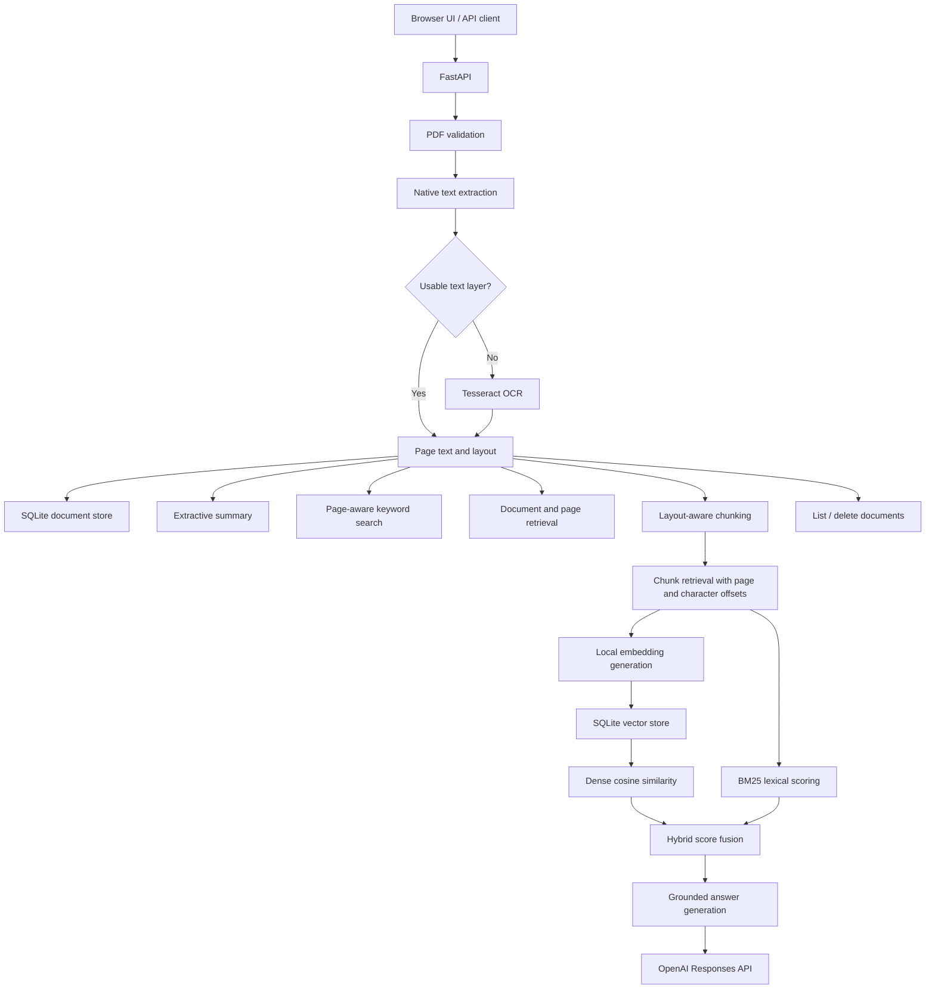

# DocuMind — Document Intelligence

A document-intelligence API and lightweight web interface that accepts text-based and scanned PDFs, extracts their text, creates extractive summaries, and searches uploaded documents.

> **Current scope:** MVP 0.11. Summaries are extractive (selected from the source text), not LLM-generated. Uploaded document text and metadata are stored in a local SQLite database. Scanned PDFs are processed with optional page-level OCR. Tesseract and its language data must be installed.

## Features

- PDF upload with file signature, size, content-type, and page-count validation
- Text extraction with PyMuPDF
- OCR fallback for image-based or text-sparse pages using Tesseract
- Heuristic two-column reading-order reconstruction with full-width heading and footer handling
- Extractive summaries using a transparent baseline algorithm
- Keyword-based search across saved documents
- SQLite persistence with page-level text records
- Document metadata and page retrieval endpoints
- Page-aware keyword search results with source locations
- PDF text-block geometry: bounding boxes, line-level coordinates, span-level coordinates, font names, and font sizes
- Word-level coordinates, native PyMuPDF table extraction, and geometry-based heuristic fallback
- Table cell coordinates, column indexes, estimated merged-cell spans, and header metadata
- Cross-page table continuation links when adjacent page geometry and column counts match
- Persisted, overlapping page-aware text chunks with exact character offsets
- Local dense embeddings using FastEmbed and the BAAI/bge-small-en-v1.5 model
- Hybrid retrieval that combines dense cosine similarity with BM25 lexical relevance
- Explicit document indexing and semantic search with page-level provenance
- Grounded RAG answers with source labels and page-level citations
- Layout inspection endpoint for page-by-page text blocks
- Document listing and deletion
- FastAPI endpoints and interactive Swagger documentation
- Automated API tests, including a real scanned-PDF OCR integration test, and GitHub Actions CI

## Architecture



## Web workbench

The root route (/) serves a responsive document workspace for uploading PDFs, browsing saved files, reviewing extractive summaries and page extraction metadata, indexing documents, running keyword or semantic search, asking evidence-grounded questions, and inspecting extracted table candidates. The UI uses the same FastAPI endpoints documented below; the interactive API reference remains available at /docs.

## Run locally

Requires Python 3.10 or newer.

```powershell
python -m venv .venv
.venv\Scripts\Activate.ps1
python -m pip install -r requirements.txt
python -m uvicorn app.main:app --reload
```

Open:
- App: http://127.0.0.1:8000
- Swagger UI: http://127.0.0.1:8000/docs
- Health check: http://127.0.0.1:8000/health

OCR is triggered for pages with very little native text when the page contains raster images or vector drawings. Completely blank pages are left untouched. OCR uses Tesseract through PyMuPDF at 200 DPI by default. Set `DOCUMIND_OCR_LANGUAGE` to a Tesseract language code such as `eng` or `eng+fra`, and `DOCUMIND_OCR_DPI` to change the render resolution. Tesseract is a separate system dependency, not a Python package. On Windows, install Tesseract OCR and its language data, then set `TESSDATA_PREFIX` to the `tessdata` directory. The Docker image installs Tesseract and English language data automatically. OCR is slower than native text extraction.

The default SQLite database is created at `data/documind.db`. Set `DOCUMIND_DB_PATH` to use another location. FastEmbed downloads its default model on the first indexing request and caches it locally. Set `DOCUMIND_EMBEDDING_MODEL` to select another supported model and `FASTEMBED_CACHE_PATH` to change the model cache directory. Copy `.env.example` to `.env` and add an OpenAI API key to enable generated answers.

## Run tests

```powershell
python -m pytest -v
```

## API

| Method | Endpoint | Purpose |
|---|---|---|
| GET | `/health` | Service health |
| POST | `/documents/upload` | Validate, extract, and save a PDF |
| GET | `/documents` | List saved documents |
| GET | `/documents/{document_id}` | Retrieve document metadata |
| GET | `/documents/{document_id}/pages` | Retrieve extracted text by page, including extraction method, OCR status, and layout classification |
| GET | `/documents/{document_id}/layout` | Retrieve text blocks, page coordinates, font metadata, and layout classification |
| GET | `/documents/{document_id}/tables` | Return structured table candidates, cell geometry, and likely cross-page continuations |
| GET | `/documents/{document_id}/chunks` | Retrieve persisted text chunks with page and character offsets |
| POST | `/documents/{document_id}/index` | Generate and persist local embeddings for a document's chunks |
| POST | `/documents/semantic-search` | Search indexed chunks by semantic similarity, with page provenance |
| POST | `/documents/ask` | Answer a question using retrieved document evidence and source labels |
| GET | `/documents/{document_id}/summary` | Return an extractive summary |
| DELETE | `/documents/{document_id}` | Delete a saved document |
| POST | `/documents/search` | Search saved documents by keyword; results include page numbers |

## Current extraction model

Each uploaded PDF is stored as a document record plus one text record per page. Search results include the page number, making it possible to trace a match back to its source location. Existing documents created before page-level storage are migrated into a page-one record when the application starts.

The layout endpoint preserves text-block bounding boxes, page dimensions, block and line bounding boxes, span coordinates, font names, and font sizes from PyMuPDF. Page and layout retrieval report whether native extraction or OCR was used and classify the page as single-column or two-column. When two columns are detected, extracted text is reordered top-to-bottom within the left column, then top-to-bottom within the right column. Full-width lines are treated as separators between vertical reading bands. This remains a geometry heuristic: pages with sidebars, uneven columns, complex tables, or unusual magazine layouts may be classified incorrectly.

## Table extraction model

Table extraction first uses PyMuPDF's native `Page.find_tables()` implementation, trying ruled-line detection and then text-alignment detection. It stores the extracted cell text, bounding boxes, row and column indexes, and available header metadata. Cell widths are compared with the table's detected x-coordinate boundaries to estimate column spans. Empty cells and merged-cell placeholders can still be ambiguous in some PDFs, so estimated spans should be treated as structural hints rather than guaranteed source semantics.

When native table detection returns no result, DocuMind falls back to its earlier geometry heuristic. Tables on adjacent pages are linked as likely continuations only when the previous table reaches the lower page region, the next begins near the top, and their column counts and relative widths are similar. The endpoint links these page-level candidates; it does not yet combine them into one cross-page table object. PyMuPDF's table detection is geometry-based and may still require tuning for irregular or borderless layouts. See the [PyMuPDF table extraction documentation](https://pymupdf.readthedocs.io/en/latest/page.html#tables-and-related-classes).

## Chunking model

Text is split independently on each page into chunks of up to 1,200 characters with a 150-character overlap. The splitter prefers paragraph, sentence, and word boundaries. Each chunk stores its page number, zero-based start offset, end-exclusive offset, and text. These references allow later retrieval results to point back to their original page and exact text range. Existing documents are backfilled into the chunk table when the application starts.

Chunking is a deterministic preprocessing step. Semantic indexing uses FastEmbed's local ONNX runtime with `BAAI/bge-small-en-v1.5` (384 dimensions by default). The first indexing request downloads the model; subsequent requests reuse the local cache. No hosted embedding API key is required. See the [FastEmbed quickstart](https://qdrant.github.io/fastembed/Getting%20Started/) for model and runtime details.

To index a document, call `POST /documents/{document_id}/index`. Then call `POST /documents/semantic-search` with a query. Search results include the source document, page, chunk index, character offsets, the dense semantic score, the BM25 lexical score, and a hybrid score. The hybrid score is 75% cosine similarity and 25% normalised BM25 relevance. The current vector store is SQLite JSON plus an in-process cosine scan; BM25 is also calculated in-process over the compatible indexed chunks. This is appropriate for a small portfolio MVP, not for large-scale production retrieval; a dedicated vector database can replace it later.

## Grounded question answering

Call `POST /documents/ask` after indexing a document. The endpoint retrieves the most similar chunks, passes only those excerpts to the OpenAI Responses API, and returns the answer with source records (`S1`, `S2`, etc.). The system instruction treats document text as untrusted data, requires citations for factual claims, and tells the model to say when the indexed evidence is insufficient. The application also rejects generated answers that contain no known source label. This is a basic citation check, not a proof that every claim is entailed by its cited passage; review the returned source excerpts.

This endpoint requires `OPENAI_API_KEY`; the default model is `gpt-5.5`, configurable through `OPENAI_MODEL`. API usage may incur charges. The automated tests mock the generation provider and do not make paid API calls. See the [OpenAI Responses API documentation](https://developers.openai.com/api/docs/quickstart) for the generation interface.

## Next milestones

1. Expand the retrieval benchmark with permission-cleared real documents and manually reviewed relevance labels.
2. Add answer-level evaluation for factual support, citation entailment, and abstention quality.
3. Add multi-user identity and role-based access control, then move larger corpora to a dedicated vector database.

## Retrieval evaluation

DocuMind includes a repeatable page-level semantic retrieval benchmark. It generates a synthetic 12-page travel policy with 24 manually authored queries and known relevant pages, uploads and indexes it through the API, and reports Precision@k, Recall@k, MRR@k, and nDCG@k. Run it with:

```powershell
python scripts/evaluate_retrieval.py --k 3 --report evaluation/results.json
```

The first run may download the local embedding model. The benchmark is a synthetic engineering baseline, not an industry dataset. Run it at both k=3 and k=1 to inspect top-result accuracy and the quality of the broader result set. It measures page retrieval only; it does not establish answer factuality or citation entailment. See [evaluation/README.md](evaluation/README.md) for metric definitions and limitations.

## Security notes

The MVP enforces a 10 MB upload limit and a 100-page limit. It does not yet include authentication, malware scanning, or production-grade rate limiting. OCR quality depends on scan resolution, contrast, skew, language-pack availability, and document quality; recognised text should be checked against the original page. Uploaded text is stored locally without encryption. Do not upload confidential documents to an internet-facing instance.

## API security and request observability

Set `DOCUMIND_API_KEY` to a long random secret to protect every `/documents` API route. When the variable is configured, requests must include the `X-API-Key` header. The workbench displays an unlock prompt and keeps the key in the current browser tab's session storage; it is not written to local storage or returned by the auth-status endpoint. When the variable is unset, the application runs without API-key authentication for local development.

The service also returns a validated `X-Request-ID`, adds standard browser security headers, and writes structured request logs to standard output with method, path, status, duration, and request ID. Request logs do not include document text, API keys, or query parameters.

API-key authentication is a lightweight single-secret gate, not multi-user identity management or role-based access control. Use HTTPS for any remote deployment, keep secrets out of source control, and do not expose an unauthenticated instance to the public internet.

## Run with Docker

```powershell
Copy-Item .env.example .env
# Set DOCUMIND_API_KEY and OPENAI_API_KEY in .env when required.
docker compose up --build
```

The application is then available at http://127.0.0.1:8000. The Docker image includes Tesseract OCR and the English language pack. The SQLite database is stored in the persistent `documind_data` volume, and the local embedding model cache is stored in `documind_models`. Docker Compose passes API keys and model/OCR settings from the local `.env` file into the container.

## Container hardening

The Docker image runs as the non-root `appuser` (UID 10001), creates writable data/model-cache directories before switching users, and includes a health check against `/health`. Docker Compose runs with a read-only root filesystem, a temporary `/tmp`, dropped Linux capabilities, `no-new-privileges`, bounded JSON logs, and persistent volumes for the SQLite database and embedding model cache. The host port is bound to `127.0.0.1`; use a TLS-terminating reverse proxy for remote access.

The `.dockerignore` file excludes local environment files, databases, model caches, tests, and Git metadata from the build context.

## Continuous integration

GitHub Actions runs the automated test suite on pushes to `main` and `develop`, and on pull requests targeting `main`, using Python 3.11 and 3.12.

## License

MIT
